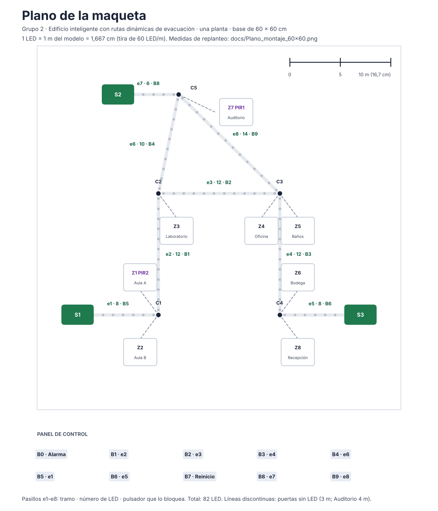

# Edificio inteligente con rutas dinámicas de evacuación

**Grupo 2 · Modelos y Simulación · Componente Práctico 2 · UNEMI**

Ante una zona bloqueada o una emergencia simulada, el sistema calcula la ruta segura de cada zona con un grafo ponderado y la muestra con una tira LED en la maqueta.

## Estado

| Fase | Estado | Documento |
|---|---|---|
| 0. Arranque | Cerrada | [Fase 0](docs/Fase_0.md) |
| 1. Modelo y simulación previa | Modelo, simulación y [proyecto Wokwi](https://wokwi.com/projects/480903247493856257) hechos y probados. Faltan las capturas de evidencia y el estudio del código por el grupo | [Fase 1](docs/Fase_1.md) |
| 2. Hardware incremental | Materiales completos, plano de replanteo para la base de 60 × 60 cm y guía de montaje listos. Falta armar y probar la maqueta | [Fase 2](docs/Fase_2.md) |
| 3. Servidor y dashboard | Servidor Django, API, dashboard en tiempo real, ESP32 simulado, puente USB para la maqueta y 49 pruebas hechos. Falta probarlo en el equipo de cada integrante y con la placa | [Fase 3](docs/Fase_3.md) |
| 4. Integración y pruebas | Pendiente | |
| 5. Cierre | Pendiente | |

## Contenido

| Carpeta | Uso |
|---|---|
| [`modelo/grafo.json`](modelo/grafo.json) | Grafo del edificio: nodos, pasillos, LED, pulsadores y pines. Fuente única del proyecto. |
| [`simulacion/`](simulacion) | Modelo en Python con NetworkX, escenarios, ajuste de curvas y resultados. |
| [`backend/`](backend) | Servidor Django y dashboard (Fase 3). Pasos en [`backend/README.md`](backend/README.md). |
| [`firmware/evacuacion_esp32/`](firmware/evacuacion_esp32) | Sketch del ESP32 y archivos del proyecto Wokwi. |
| [`firmware/verificacion_esp32/`](firmware/verificacion_esp32) | Prueba mínima de la placa por USB para el inicio de la Fase 2. |
| [`herramientas/`](herramientas) | Generadores de `grafo.h`, `diagram.json` y el plano de replanteo a partir de `grafo.json`. |
| [`pruebas/`](pruebas) | Verificación del firmware en la PC frente al modelo. |
| [`docs/`](docs) | Fases, plano, guía de entorno y evidencias. |



La maqueta va en un tablero de 60 × 60 cm, con el plano de un edificio de una planta: muros, salas con puerta, pasillos en ángulo recto y salidas en las fachadas. Medidas de replanteo: [`docs/Plano_montaje_60x60.png`](docs/Plano_montaje_60x60.png).

## Uso rápido

```bash
git clone https://github.com/Mentaaa365/edificio-inteligente-grupo2.git
cd edificio-inteligente-grupo2
```

Sigue la [guía de Windows](docs/Entorno_Windows.md) para Python 3.13 y luego:

```powershell
.\.venv\Scripts\python.exe simulacion\simulacion_grafos.py
.\.venv\Scripts\python.exe pruebas\verificar.py
```

Si cambias `modelo/grafo.json`, regenera los archivos derivados:

```powershell
.\.venv\Scripts\python.exe herramientas\generar_grafo_h.py
.\.venv\Scripts\python.exe herramientas\generar_diagrama_wokwi.py
.\.venv\Scripts\python.exe herramientas\plano_montaje.py
```
