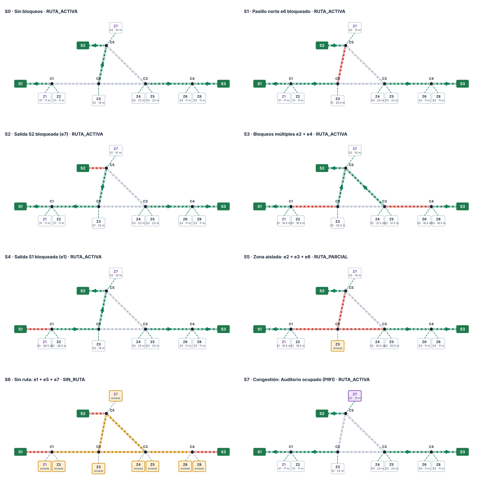
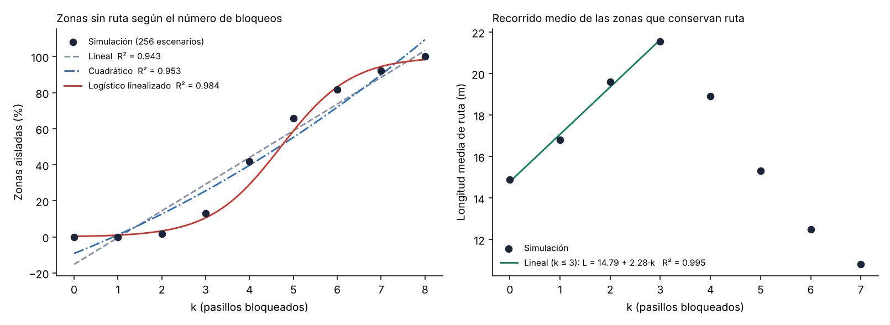

# Fase 1. Modelo y simulación previa

**Grupo 2 · Modelos y Simulación · UNEMI · Días 3 a 7**

En esta fase no se usa hardware. El edificio se modela como un grafo, se simulan las emergencias en Python y el firmware se prueba en Wokwi con las mismas piezas de la lista de compras.

| Entregable del cronograma | Archivo | Estado |
|---|---|---|
| `grafo.json` | [`modelo/grafo.json`](../modelo/grafo.json) | Hecho |
| Simulación con NetworkX y escenarios | [`simulacion/`](../simulacion) | Hecho, con resultados en `simulacion/resultados/` |
| Proyecto Wokwi | [wokwi.com/projects/480903247493856257](https://wokwi.com/projects/480903247493856257) y [`firmware/evacuacion_esp32/`](../firmware/evacuacion_esp32) | Creado, guardado y probado: la tabla de pruebas de la sección 4 se cumple completa |

## 1. Modelo

**Grafo.** G = (V, E, w), no dirigido y ponderado, con 16 nodos (3 salidas, 5 intersecciones, 8 zonas) y 16 aristas (8 pasillos con LED y 8 puertas). `modelo/grafo.json` es la única fuente: de él salen el plano, el `grafo.h` del firmware y el circuito de Wokwi.

**Peso dinámico de una arista** (lo recalculan igual Python y el ESP32):

```
w_e(t) = d_e · (1 + α·o_e(t)) · (1 + β·r_e(t))     si el pasillo está libre
w_e(t) = ∞                                          si el pasillo está bloqueado
```

| Símbolo | Significado | Valor |
|---|---|---|
| d_e | Longitud en metros. En los pasillos es el número de LED | 6 a 14 m; puertas 3 m (Auditorio 4 m) |
| o_e | 1 si el pasillo toca la intersección de una zona con presencia (PIR) | entrada |
| r_e | 0,5 si la arista comparte un nodo con un pasillo bloqueado | entrada derivada |
| α | Peso de la congestión | 0,5 |
| β | Peso del riesgo | 1,0 |
| v | Velocidad de marcha para estimar el tiempo | 1,2 m/s (supuesto por justificar con bibliografía) |

Para que el ESP32 y Python den exactamente el mismo número, el costo se guarda como entero en diezmilésimas de metro: `w = d · (100 + 50·o) · (100 + 100·r_pct/100)`.

**Entradas:** pulsadores B1–B6, B8 y B9 (bloqueo de e1–e8), B0 (alarma), B7 (reinicio), PIR1 (Z7) y PIR2 (Z1).
**Salidas:** color de cada LED, buzzer y una línea JSON por evento.
**Estados:** `INICIALIZANDO → NORMAL → RUTA_ACTIVA / RUTA_PARCIAL / SIN_RUTA`. `RUTA_PARCIAL` significa que alguna zona quedó aislada y `SIN_RUTA` que ninguna puede salir.

**Algoritmo.** Dijkstra multi-fuente: las tres salidas parten con distancia 0 y una sola pasada da, para cada nodo, el costo hasta su salida más cercana. Luego cada nodo guarda la arista por la que debe salir, y la tira muestra ese "campo de evacuación" completo: verde animado hacia la salida, rojo fijo en los bloqueos, ámbar intermitente en los tramos aislados y rojo intermitente si nadie puede salir. Si dos caminos empatan se elige la arista de menor índice; esa regla es la misma en los dos lados.

## 2. Cómo ejecutar la simulación

```powershell
.\.venv\Scripts\python.exe -m pip install -r simulacion\requirements.txt
.\.venv\Scripts\python.exe simulacion\simulacion_grafos.py
```

| Archivo | Contenido |
|---|---|
| `simulacion/modelo.py` | Carga del grafo, pesos, Dijkstra multi-fuente, validación con NetworkX, Dijkstra/A*/BFS de un origen |
| `simulacion/plano.py` | Dibujo del plano y de cada escenario |
| `simulacion/simulacion_grafos.py` | Escenarios, comparación de algoritmos, sensibilidad a α, barrido de bloqueos y ajuste de curvas |
| `herramientas/generar_grafo_h.py` | Regenera `grafo.h` cuando cambia `grafo.json` |
| `herramientas/generar_diagrama_wokwi.py` | Regenera `diagram.json` cuando cambia `grafo.json` |

## 3. Resultados

### Escenarios (`fig1_escenarios.png`, `escenarios_rutas.csv`)

| Esc. | Condición | Estado | Zonas aisladas | Recorrido medio | Recorrido máximo | Tiempo máximo |
|---|---|---|---:|---:|---:|---:|
| S0 | Sin bloqueos | RUTA_ACTIVA | 0 | 14,88 m | 23 m | 19,2 s |
| S1 | e6 bloqueado | RUTA_ACTIVA | 0 | 15,38 m | 23 m | 19,2 s |
| S2 | e7 bloqueado (salida S2) | RUTA_ACTIVA | 0 | 18,38 m | 34 m | 28,3 s |
| S3 | e2 + e4 bloqueados | RUTA_ACTIVA | 0 | 14,88 m | 23 m | 19,2 s |
| S4 | e1 bloqueado (salida S1) | RUTA_ACTIVA | 0 | 19,88 m | 31 m | 25,8 s |
| S5 | e2 + e3 + e6 bloqueados | RUTA_PARCIAL | 1 (Z3) | 14,29 m | 23 m | 19,2 s |
| S6 | e1 + e5 + e7 bloqueados | SIN_RUTA | 8 | — | — | — |
| S7 | Auditorio ocupado (PIR1) | RUTA_ACTIVA | 0 | 15,38 m | 23 m | 19,2 s |



Lectura de los resultados:

- **La salida norte es la más sensible.** Perder S2 (S2) sube el recorrido máximo de 23 a 34 m, porque el Auditorio debe cruzar hasta S1. Perder S1 (S4) lo sube a 31 m.
- **e8 da redundancia, no rapidez.** Sin bloqueos nadie usa e8 ni e3. En S3, con e2 y e4 bloqueados, e8 permite que Oficina y Baños salgan por S2 con el mismo recorrido de 23 m.
- **Empate en C3.** Desde C3 hay 20 m tanto a S3 (e4 + e5) como a S2 (e8 + e7). El modelo necesita una regla de desempate y se documenta.
- **Tres bloqueos bastan para dejar a todos sin salida** (e1, e5 y e7, uno por salida), y otros tres aíslan solo al Laboratorio.

### Sensores que alimentan el modelo (`fig3_sensibilidad_alfa.png`)

Con el Auditorio ocupado, los pasillos de C5 se penalizan. El Laboratorio (Z3) cambia de la salida S2 a la S1 a partir de **α = 0,25**, porque 16·(1 + α) supera los 20 m del camino alternativo. Con el valor adoptado, α = 0,5, el PIR sí modifica la ruta; con α < 0,25 el sensor no tendría efecto.

### Dijkstra, A* y BFS (`fig2_algoritmos.png`, `algoritmos.csv`)

En 55 casos (cada zona en cada escenario con ruta), A* encuentra el mismo costo que Dijkstra expandiendo 4,0 nodos de media frente a 6,2 (con las coordenadas del plano de 60 × 60 cm; con las de la base anterior eran 3,7). La heurística es la distancia en línea recta a la salida más cercana, que nunca supera el costo real porque cada pasillo mide en la base lo mismo que su número de LED (en e6 y e8, que van en L, la recta entre sus extremos es incluso más corta) y cada puerta está a menos de su largo de su intersección. BFS, que cuenta tramos y no metros, falla en un caso: en S0 manda al Laboratorio por S1 (23 m) cuando por S2 son 19 m, con el mismo número de tramos.

### Barrido de bloqueos y ajuste de curvas (`fig4_barrido_ajuste.png`, `barrido_bloqueos.csv`)

Con 8 pasillos hay 2⁸ = 256 combinaciones de bloqueo, así que se evalúan todas: el resultado es exacto, no una muestra.

| k bloqueos | Escenarios | Zonas aisladas | Escenarios sin ninguna ruta | Recorrido medio |
|---:|---:|---:|---:|---:|
| 0 | 1 | 0 % | 0 % | 14,88 m |
| 1 | 8 | 0 % | 0 % | 16,81 m |
| 2 | 28 | 1,79 % | 0 % | 19,60 m |
| 3 | 56 | 13,17 % | 1,79 % | 21,55 m |
| 4 | 70 | 41,79 % | 7,14 % | 18,91 m |
| 5 | 56 | 65,85 % | 17,86 % | 15,32 m |
| 6 | 28 | 81,70 % | 35,71 % | 12,49 m |
| 7 | 8 | 92,19 % | 62,50 % | 10,80 m |
| 8 | 1 | 100 % | 100 % | — |



- **El edificio tolera cualquier bloqueo único**: con k = 1 ninguna zona queda aislada.
- **Zonas aisladas frente a k** (mínimos cuadrados): lineal R² = 0,943; cuadrático R² = 0,953; logístico linealizado, ln(p/(1−p)) = −5,86 + 1,24·k, R² = 0,984. La curva tiene forma de S, por eso el logístico ajusta mejor. El punto medio está en k ≈ 4,7.
- **Recorrido medio para k ≤ 3**: L = 14,79 + 2,28·k, R² = 0,995. Cada bloqueo añade unos 2,3 m. Desde k = 4 el promedio baja, pero no porque se evacúe mejor: solo conservan ruta las zonas pegadas a una salida.

## 4. Simulación del circuito en Wokwi

El circuito usa las piezas de la lista de compras: ESP32 DevKit, 82 LED WS2812 en ocho tramos colocados y girados según el plano, 10 pulsadores, 2 PIR y el buzzer. El proyecto ya está creado: [wokwi.com/projects/480903247493856257](https://wokwi.com/projects/480903247493856257). Para rehacerlo desde cero:

1. Entra en [wokwi.com](https://wokwi.com), inicia sesión y crea un proyecto **ESP32** con Arduino.
2. Sustituye el contenido de `sketch.ino` por el de `evacuacion_esp32.ino` y el de `diagram.json` por el del repositorio.
3. Con la flecha junto a las pestañas elige **New file** y crea `config.h`, `grafo.h`, `rutas.h` y `libraries.txt`, pegando el contenido de cada uno.
4. Pulsa **Start**. Tras 3 s la tira pasa de azul a apagada y el monitor serie muestra el evento `LISTO`.

Cada prueba parte de un reinicio (`7`) seguido de la alarma (`0`).

| Prueba | Acción (teclas 0–9 = B0–B9) | Resultado esperado |
|---|---|---|
| Alarma | `0` | Rutas en verde avanzando hacia S1, S2 y S3; buzzer; JSON con `RUTA_ACTIVA` |
| Bloqueo | `4` | e6 en rojo; el Laboratorio pasa a salir por S1 |
| Salida bloqueada | `8` | e7 en rojo; el Auditorio se desvía |
| Congestión | Clic en PIR1 → *Simulate motion* | `"ocupadas":["Z7"]` y cambio de costos durante 6 s |
| Zona aislada | `1`, `2`, `4` | Tramo aislado en ámbar intermitente; `RUTA_PARCIAL` |
| Sin ruta | `5`, `6`, `8` | Todo en rojo intermitente; `SIN_RUTA`; buzzer rápido |
| Reinicio | `7` | Tira apagada; `NORMAL` |

Si el bucle `loop()` no tuviera la pausa de 2 ms (`PAUSA_CICLO_MS`), Wokwi simularía a menos del 10 % de la velocidad real.

Diferencias con la maqueta real: en `config.h`, `SIMULACION 1` usa `tone()` para el buzzer pasivo de Wokwi y espera 3 s a los PIR. En la maqueta se pone en `0`: el zumbador activo TMB12A05 suena con el GPIO 23 en alto a través de un transistor NPN, y los PIR esperan 60 s. Wokwi usa la placa ESP32 DevKit C de 38 pines; la de la maqueta es una DevKit de 30 pines con CH340, con los mismos números de GPIO. En el diagrama los LED solo llevan el cable de datos; en la maqueta la tira se alimenta desde la fuente de 5 V con tierra común, condensador de 1000 µF y resistencia de 330–470 Ω en la línea de datos.

## 5. Verificación sin hardware

```powershell
.\.venv\Scripts\python.exe pruebas\verificar.py
```

Necesita `g++`. Compila en la PC el mismo `rutas.h` del firmware y el sketch completo con un Arduino simulado.

| Comprobación | Resultado al 16 de noviembre de 2026 |
|---|---|
| Firmware (C++) frente a Python y NetworkX, en las 256 × 256 combinaciones de bloqueos y zonas ocupadas | 65 536 de 65 536 iguales: costos, siguiente arista, salida asignada y zonas aisladas |
| Sketch completo en PC: 16 pasos con rebotes en los pulsadores | 16 de 16: un solo evento por pulsación, estado, rutas del JSON y color de cada tramo |
| Compilación para ESP32 en Wokwi | Correcta. El programa arranca y emite `LISTO` con las ocho rutas del escenario S0 |
| Alarma (B0) en Wokwi | `RUTA_ACTIVA`; e1, e4, e5, e6 y e7 en verde con el punto brillante avanzando hacia la salida; e2, e3 y e8 apagados |
| Bloqueos (B4, B8, B9) | e6 en rojo y Laboratorio a S1 (30,50 m); con e6 + e7 el Auditorio sale por e8 hasta S3 (47 m); con e6 + e7 + e8 queda aislado y el estado pasa a `RUTA_PARCIAL` |
| Zona aislada (e2 + e3 + e7 + e8) | 2 zonas aisladas; e6 en ámbar intermitente; bloqueos en rojo fijo |
| Sin ruta (e1 + e5 + e7) | `SIN_RUTA`; pasillos libres en rojo intermitente y bloqueados en rojo fijo |
| Reinicio (B7) | `NORMAL`, tira apagada. Un bloqueo sin alarma se ve en rojo tenue |
| PIR1 (*Simulate motion*) | `"ocupadas":["Z7"]`; el Laboratorio cambia de S2 (19 m) a S1 (23 m) y vuelve a los 6 s |
| Velocidad y tiempo de cálculo | Simulación al 100 % de la velocidad real; Dijkstra en unos 700 µs simulados |

Las pruebas de Wokwi se hicieron el 16 de noviembre de 2026 leyendo el JSON del monitor serie y el color de cada LED. El navegador pausa la simulación si la pestaña queda oculta.

## 6. Qué falta para cerrar la Fase 1

1. Repetir en Wokwi la tabla de pruebas de la sección 4 y guardar capturas propias en `docs/evidencias/`.
2. Ejecutar la simulación y `verificar.py` en el equipo de cada integrante.
3. Justificar con bibliografía la velocidad de marcha y decidir si α, β y el riesgo se mantienen.
4. Estudio del código por los tres. El docente no acepta código generado sin comprender y evalúa a cada uno por separado: cada integrante debe poder explicar el peso de una arista, por qué se usa Dijkstra multi-fuente, el desempate, el antirrebote y la animación, y hacer en vivo un cambio como modificar una longitud en `grafo.json` y regenerar.

## Referencias

Adafruit Industries. (s. f.). *Adafruit NeoPixel Überguide: Best practices*. https://learn.adafruit.com/adafruit-neopixel-uberguide/best-practices

NetworkX Developers. (s. f.). *multi_source_dijkstra_path_length*. NetworkX documentation. https://networkx.org/documentation/stable/reference/algorithms/generated/networkx.algorithms.shortest_paths.weighted.multi_source_dijkstra.html

Wokwi. (s. f.-a). *diagram.json file format*. Wokwi Docs. https://docs.wokwi.com/diagram-format

Wokwi. (s. f.-b). *ESP32 simulation*. Wokwi Docs. https://docs.wokwi.com/guides/esp32

Wokwi. (s. f.-c). *wokwi-neopixel reference*. Wokwi Docs. https://docs.wokwi.com/parts/wokwi-neopixel

Wokwi. (s. f.-d). *wokwi-pir-motion-sensor reference*. Wokwi Docs. https://docs.wokwi.com/parts/wokwi-pir-motion-sensor

Wokwi. (s. f.-e). *wokwi-pushbutton reference*. Wokwi Docs. https://docs.wokwi.com/parts/wokwi-pushbutton

Yen, H.-H., & Lin, C.-H. (2024). Intelligent evacuation sign control mechanism in IoT-enabled multi-floor multi-exit buildings. *Sensors, 24*(4), 1115. https://doi.org/10.3390/s24041115
