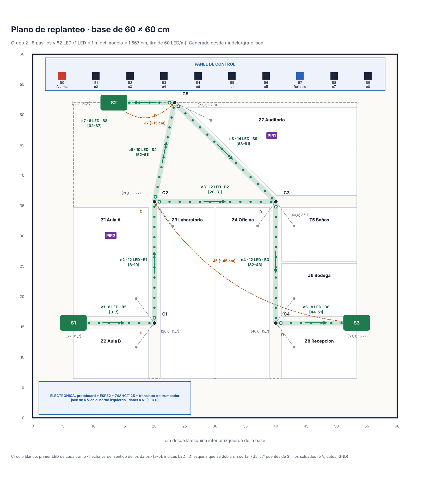

# Fase 2. Montaje de la maqueta

**Grupo 2 · Modelos y Simulación · UNEMI**  
**Guía preparada el 20 de noviembre de 2026 · Montaje a cargo del grupo**

La maqueta se arma sobre un tablero MDF de **60 × 60 cm**. Los 8 pasillos, los 82 LED, los índices de la tira y los pesos del modelo son los mismos de las fases 0, 1 y 3; solo cambia la disposición: el pasillo largo S1–C1–C2–C3–C4–S3 se pliega en forma de U. Por eso el firmware, la simulación y el servidor siguen valiendo sin cambios en el cálculo. Las coordenadas de `modelo/grafo.json` ya están en la nueva base, y de ellas salen el plano, el diagrama de Wokwi y el plano de replanteo.

| Entregable | Archivo | Estado |
|---|---|---|
| Lista de materiales comprados | Sección 1 | Hecha |
| Plano de replanteo con medidas | [`Plano_montaje_60x60.png`](Plano_montaje_60x60.png), generado por [`herramientas/plano_montaje.py`](../herramientas/plano_montaje.py) | Hecho |
| Plano del modelo | [`Plano_Fase_0.png`](Plano_Fase_0.png) | Actualizado a 60 × 60 cm |
| Montaje y pruebas por etapas | Secciones 3 a 5 | Pendiente: lo hace el grupo |

## 1. Materiales

### Comprado por el grupo

| Material | Cant. | Uso en la maqueta |
|---|---:|---|
| Módulo ESP32 WROOM, 30 pines, CH340, USB-C | 1 | Controlador. Necesita el controlador CH340 en Windows ([guía de entorno](Entorno_Windows.md)) |
| Sensor de movimiento HC-SR501 | 4 | PIR1 en Z7 (Auditorio) y PIR2 en Z1 (Aula A). Dos quedan de repuesto |
| Pulsador 12 × 12 mm de dos patas | 12 | B0–B9. Dos quedan de repuesto |
| Jack hembra 2,1 mm con bornera ("balun"), 12 V máx. | 1 | Entrada de la fuente de 5 V. El 12 V es el máximo que soporta, no la tensión de trabajo |
| Condensador electrolítico 1000 µF, 25 V | 2 | Reserva de energía en la entrada de la pieza A (S1) y de la pieza B (C2) |
| Condensador cerámico 100 nF ("104") | 2 | Desacople del 74AHCT125 entre sus patas 14 y 7; uno de repuesto |
| Resistencia 330 Ω, 1/2 W | 2 | Serie en la línea de datos de la tira; una de repuesto |
| Protoboard WB-102 | 1 | Electrónica (ESP32, 74AHCT125, transistor) |
| Jumpers macho-macho y macho-hembra, 20 cm | 12 + 12 | Conexiones en la protoboard y a los pines de los PIR |
| Cable UTP Cat-5e | 4 m | Hilos rígidos para pulsadores, PIR, puentes de la tira y alimentación (dos hilos por polo) |
| Zumbador activo TMB12A05 | 1 | Alarma sonora. Es de 5 V nominales y hasta 30 mA, así que se enciende con un transistor desde el GPIO 23 |
| Tablero MDF crudo 0,60 × 0,60 m, 9 mm | 1 | Base de la maqueta |
| Cautín 40 W, 2 m de estaño, pinza punta recta, multímetro | 1 c/u | Puentes de la tira, cables de pulsadores y comprobaciones |
| Pegamento instantáneo UHU, cinta doble faz, cinta aislante, estilete o tijeras | — | Fijar la tira y los pliegues, aislar uniones, cortar |
| Cable USB-C de datos | 1 | Programación y enlace serie con el servidor (`puente_serial`) |

### Lo que faltaba (dado por comprado)

| Material | Cant. | Por qué |
|---|---:|---|
| Tira LED **WS2812B 5 V, 60 LED/m, IP30**, PCB de 10 mm | 2 × 1 m | La tira Foco71 es RGB analógica de 12 V: todos sus LED muestran el mismo color, así que no puede marcar una ruta por pasillo. La WS2812B permite un color por LED |
| Circuito integrado **74AHCT125N** (DIP-14) | 1 | Convierte la señal de 3,3 V del ESP32 a 5 V. El 74LS125AN comprado solo garantiza 2,4 V en alto, menos que lo que pide la WS2812B (0,7 × VDD = 3,5 V) |
| Fuente **5 V, 3 A**, plug 5,5 × 2,1 mm, centro positivo | 1 | Alimenta la tira y los PIR. El adaptador de 12 V de la tira Foco71 **no se usa**: dañaría la tira WS2812B |
| Transistor NPN **2N2222A** (TO-92) | 1 | Enciende el zumbador con 5 V. A 3,3 V y directo del GPIO el TMB12A05 queda por debajo de su tensión de trabajo |
| Resistencia **1 kΩ** | 1 | Base del transistor (unos 2,6 mA) |
| Diodo **1N4148** | 1 | Protege el transistor del pico inductivo del zumbador magnético |

**No se usan:** la tira Foco71 con su adaptador de 12 V y control remoto, el 74LS125AN y los cables JST XH (se pueden cortar y aprovechar como hilos de 3 colores para los puentes de la tira).

## 2. Plano y replanteo

Todas las medidas se toman desde la **esquina inferior izquierda** del tablero, con el panel de control arriba y la electrónica abajo.

| Punto | x (cm) | y (cm) |
|---|---:|---:|
| S1 (salida oeste) | 6,7 | 15,7 |
| C1 | 20,0 | 15,7 |
| C4 | 40,0 | 15,7 |
| S3 (salida este) | 53,3 | 15,7 |
| C2 | 20,0 | 35,7 |
| C3 | 40,0 | 35,7 |
| C5 | 23,3 | 52,0 |
| S2 (salida norte) | 13,3 | 52,0 |

| Zona | Dónde |
|---|---|
| Z1 Aula A (PIR2) | Bloque izquierdo, entre e1 y e3, a la izquierda de e2 |
| Z2 Aula B | Debajo de e1 |
| Z3 Laboratorio y Z4 Oficina | Bloque central, debajo de e3, entre e2 y e4 (mitad izquierda y derecha) |
| Z5 Baños y Z6 Bodega | Bloque derecho, a la derecha de e4 (arriba y abajo) |
| Z8 Recepción | Debajo de e5 |
| Z7 Auditorio (PIR1) | A la derecha de e8, encima de e3 |

Cada pasillo mide en el tablero exactamente su número de LED × 1,667 cm: e1 y e5, 13,3 cm; e2, e3 y e4, 20 cm; e6, 16,7 cm; e7, 10 cm; e8, 23,3 cm. `plano_montaje.py` lo comprueba cada vez que se genera el plano, junto con que ninguna tira atraviese un recinto. Las paredes se pueden marcar con lápiz o con tiras de cartón de 1–2 cm de alto, dejando 1 cm libre a cada lado de la tira.

## 3. Tira LED

La tira se corta en **tres piezas** y las esquinas se doblan sin cortar:

| Pieza | Pasillos | LED | Índices | Largo | Esquinas que se doblan (entre los LED) |
|---|---|---:|---|---:|---|
| A | e1 → e2 → e3 → e4 → e5 | 52 | 0–51 | 86,7 cm | C1 (7 y 8), C2 (19 y 20), C3 (31 y 32), C4 (43 y 44) |
| B | e6 → e7 | 16 | 52–67 | 26,7 cm | C5 (61 y 62) |
| C | e8 | 14 | 68–81 | 23,3 cm | — |

La pieza A sale del primer metro y las piezas B y C del segundo (sobran 38 LED para practicar).

1. **Sentido.** Las flechas impresas en la tira van de DIN a DOUT y deben seguir las flechas verdes del plano: e1 empieza en S1, e6 en C2 y e8 en C5.
2. **Corte.** Solo por la línea marcada entre dos LED, a mitad de los pads de cobre.
3. **Pliegue en las esquinas.** Doblar la tira 45° hacia atrás y luego otra vez para formar el ángulo, justo en el espacio entre los dos LED indicados, nunca encima de un LED. Fijar el pliegue con una gota de pegamento. Practiquen primero con los LED sobrantes. Si un pliegue deja de conducir, se corta en esa línea y se puentea con tres hilos soldados como en el paso 4.
4. **Puentes soldados (3 hilos: 5 V, datos, GND).**
   - **Entrada (S1):** de la protoboard a los pads 5 V / DIN / GND del LED 0.
   - **J5 (unos 45 cm):** de los pads DOUT/5 V/GND del final de la pieza A (S3) a la entrada de la pieza B (C2). Va pegado a la base, por fuera de los recintos.
   - **J7 (unos 15 cm):** del final de la pieza B (S2) a la entrada de la pieza C (C5).
   - Usen hilos del UTP: naranja para 5 V, verde para datos y azul para GND, por ejemplo. Estañen primero el pad y el hilo, y luego únanlos en 2–3 s con el cautín. Comprueben con el multímetro, en continuidad, que no quedó un puente entre pads vecinos.
5. **Condensadores de 1000 µF:** uno entre 5 V y GND en la entrada de la pieza A (protoboard) y otro en la entrada de la pieza B (C2). La pata larga (+) va a 5 V.
6. **Pegado.** La tira trae adhesivo; refuercen con cinta doble faz. No peguen nada hasta pasar la prueba 3 de la sección 5.

## 4. Conexiones

| Desde | Hacia | Nota |
|---|---|---|
| Fuente 5 V → jack (bornera) | + a la línea roja de la protoboard, − a la azul | Dos hilos de UTP por polo. Medir 5 V con el multímetro antes de conectar nada |
| ESP32 GND | Línea azul (GND común) | El ESP32 se alimenta por USB desde el PC; **no conectar VIN** a la fuente |
| 74AHCT125 pata 14 (VCC) / 7 (GND) | 5 V / GND | Condensador de 100 nF entre las patas 14 y 7 |
| 74AHCT125 pata 1 (1OE) | GND | Activa el canal 1 |
| ESP32 GPIO 16 (RX2) | 74AHCT125 pata 2 (1A) | Datos a 3,3 V |
| 74AHCT125 pata 3 (1Y) | Resistencia 330 Ω → DIN del LED 0 | Datos a 5 V |
| 74AHCT125 patas 4, 10, 13 (2OE, 3OE, 4OE) | 5 V | Canales sin usar, desactivados |
| 74AHCT125 patas 5, 9, 12 (2A, 3A, 4A) | GND | Entradas sin usar, a un nivel fijo |
| ESP32 GPIO 23 | Resistencia 1 kΩ → base del 2N2222A | |
| 2N2222A emisor / colector | GND / pata − del zumbador | Confirmen el orden E-B-C con la hoja de datos de su transistor |
| Zumbador pata + (la más larga, marcada +) | 5 V | Diodo 1N4148 en paralelo con el zumbador: raya (cátodo) hacia 5 V |
| PIR1 (Z7): VCC / OUT / GND | 5 V / GPIO 34 / GND | Puente de disparo en **H** (repetible), tiempo al mínimo, sensibilidad media |
| PIR2 (Z1): VCC / OUT / GND | 5 V / GPIO 35 / GND | Igual que PIR1 |
| B0 Alarma / B7 Reinicio | GPIO 4 / GPIO 14 | La otra pata de cada pulsador va a GND |
| B1–B4 (e2, e3, e4, e6) | GPIO 25, 26, 27, 32 | La otra pata a GND (`INPUT_PULLUP`: pulsado = LOW) |
| B5, B6, B8, B9 (e1, e5, e7, e8) | GPIO 33, 13, 18, 19 | La otra pata a GND |

Los pulsadores van en el panel de control (borde superior). Se suelda un hilo de UTP a cada pata y el otro extremo se pincha en la protoboard. Todas las patas de GND del panel se pueden unir entre sí y bajar con un solo hilo.

**Consumo.** Con `BRILLO_GLOBAL 60` (de 255) un LED encendido en un solo color usa unos 60/255 × 20 mA ≈ 4,7 mA, así que los 82 LED en rojo intermitente (`SIN_RUTA`) piden unos 0,4 A. La fuente de 3 A sobra; la prueba P11 de la Fase 4 lo mide.

## 5. Orden de montaje y pruebas por etapas

Cada etapa se prueba antes de pasar a la siguiente. Anoten el resultado y guarden una foto o captura en `docs/evidencias/`.

| # | Etapa | Cómo se comprueba |
|---:|---|---|
| 1 | Placa | Instalar el controlador CH340 y subir `firmware/verificacion_esp32`. El Monitor serie a 115200 muestra `FASE 0 OK - ESP32` |
| 2 | Fuente y protoboard | Sin nada más conectado, el multímetro marca 5 V (±0,25 V) entre las líneas roja y azul, con la polaridad correcta |
| 3 | Pieza A con el 74AHCT125 | En `config.h` poner `#define SIMULACION 0` y subir `evacuacion_esp32`. Tras 60 s, pulsar B0 (puenteando GPIO 4 a GND): e1, e4 y e5 se ven en verde con el punto brillante hacia S1 y S3 |
| 4 | Piezas B y C | Con la alarma, e6 y e7 en verde hacia S2; e8 apagado. Con e6 bloqueado (GPIO 32 a GND), e6 en rojo |
| 5 | Pulsadores | Uno por uno, con el Monitor serie: cada pulsación produce un solo evento JSON con el pasillo correcto en `bloqueos` |
| 6 | PIR | Esperar 60 s de calentamiento. Al mover la mano a 10 cm, `"ocupadas":["Z7"]` (PIR1) o `["Z1"]` (PIR2) |
| 7 | Zumbador | Suena a ritmo lento con la alarma y rápido en `SIN_RUTA` (B5, B6 y B8) |
| 8 | Servidor | Cerrar el Monitor serie y ejecutar `manage.py puente_serial --puerto COMx`. Los eventos llegan al dashboard y aparecen como coincidentes |

Después de la etapa 8 empieza la Fase 4 (plan de pruebas P1–P11 del informe).

## 6. Seguridad

- Nunca conectar el adaptador de 12 V de la tira Foco71 ni ninguna fuente que no sea de 5 V.
- Desconectar la fuente y el USB antes de soldar o recablear.
- Los condensadores electrolíticos tienen polaridad; al revés pueden reventar.
- La fuente de 5 V y el USB del PC comparten GND, pero el 5 V de la fuente no se conecta al ESP32.
- El cautín de 40 W se apoya siempre en su base; el pegamento instantáneo se aplica con la tira desconectada.

## Referencias

Adafruit Industries. (s. f.-a). *Adafruit NeoPixel Überguide: Powering NeoPixels*. https://learn.adafruit.com/adafruit-neopixel-uberguide/powering-neopixels

Adafruit Industries. (s. f.-b). *Level shifting 3.3V microcontrollers and NeoPixels*. https://learn.adafruit.com/neopixel-levelshifter

Jiangsu Huaneng Electronics. (s. f.). *TMB12A05 specification* [Hoja de datos]. LCSC. https://wmsc.lcsc.com/wmsc/upload/file/pdf/v2/lcsc/Jiangsu-Huaneng-Elec-TMB12A05_C96093.pdf

SparkFun Electronics. (s. f.). *How to install CH340 drivers*. https://learn.sparkfun.com/tutorials/how-to-install-ch340-drivers

Texas Instruments. (2002). *SN74LS125A quadruple bus buffers with 3-state outputs* [Hoja de datos]. https://www.ti.com/lit/gpn/SN74LS125A

Texas Instruments. (s. f.). *SN74AHCT125 quadruple bus buffer gates with 3-state outputs* [Hoja de datos]. https://www.ti.com/product/SN74AHCT125

Worldsemi. (2016). *WS2812B intelligent control LED integrated light source* [Hoja de datos]. https://cdn.shopify.com/s/files/1/0174/1800/files/WS2812B-LED-datasheet.pdf
